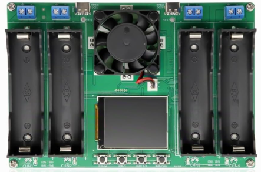
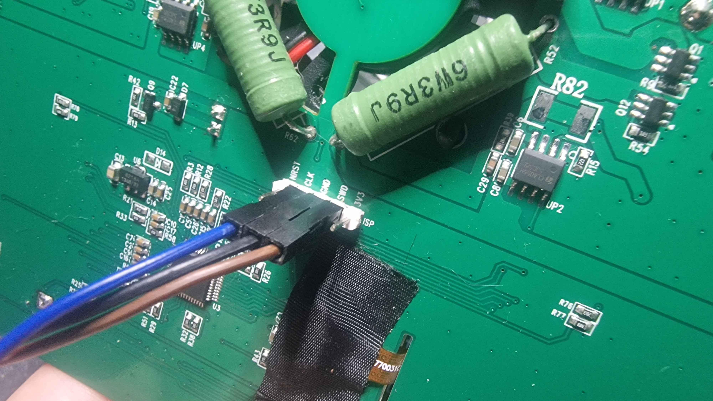
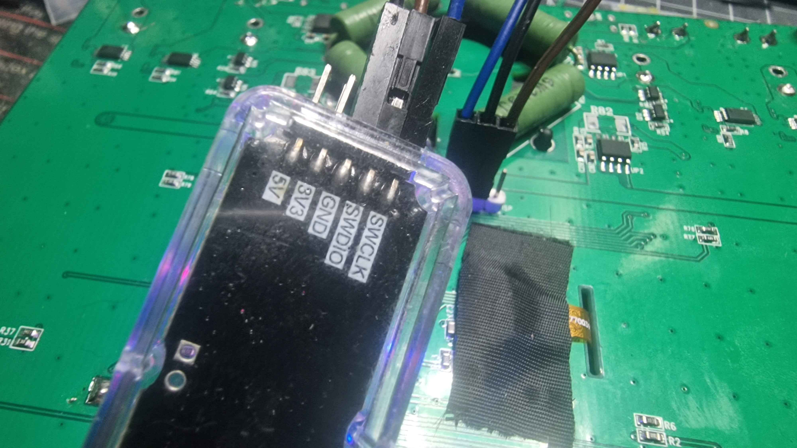
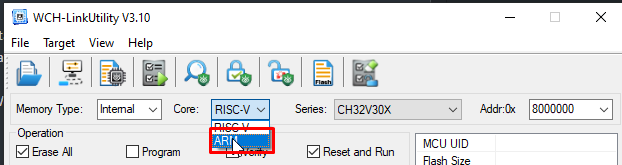
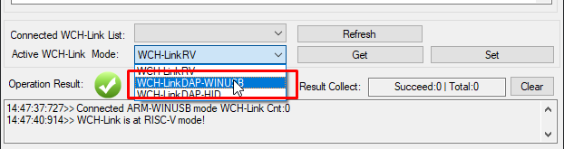
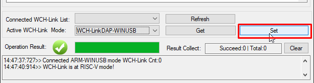
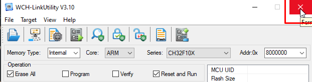

[](https://www.python.org/)
[](https://pyocd.io/)
[](https://arm-software.github.io/CMSIS_5/DAP/html/index.html)
[](https://websockets.readthedocs.io/en/stable/)
[](https://pyyaml.org/)
[](./LICENSE)

# 18650-4CHN SWD Monitor



Real-time, read-only telemetry for the **18650-4CHN** four-channel Li-ion charger/tester, read straight out of the microcontroller SRAM over SWD while the stock firmware keeps running.

The charger has no data port. Its MCU (an Arm Cortex-M0+, most likely a Puya PY32F040) exposes a working SWD interface, and the four battery slots are kept in a fixed structure in SRAM. This project attaches to the running chip with a CMSIS-DAP probe (a WCH-Link in ARM mode is enough), reads that structure once per second and turns it into typed, documented measurements. **The firmware is not modified, nothing is written to the device, and the charger keeps full control of the cells.**

You get three ways to use the data:

- a **Python library** (`chn4_bridge`) for one-shot reads and continuous acquisition,
- a **CLI** (`chn4-bridge`) to list probes, read, monitor, record, decode dumps and calibrate,
- a **WebSocket server** that streams JSON snapshots of the four channels to any number of local clients.

Everything runs locally: no cloud, no account, no telemetry. Replay and demo modes make the whole toolkit usable without the hardware.

How the memory layout was found, and how sure we are of each field, is documented in [docs/REVERSE_ENGINEERING.md](./docs/REVERSE_ENGINEERING.md).

## What has been validated

| Item | Status |
|---|---|
| SWD attach to the running charger with a WCH-Link (WCH CMSIS-DAP, ARM / DAP-WINUSB mode) and pyOCD, Python 3.11, Windows | Validated on one unit by the author |
| CPUID `0x410CC601` (Arm Cortex-M0+ r0p1) | Read on that unit |
| Channel structures at `0x20000048`, stride `0x38`, four slots | Validated against the device display on that unit |
| ADC buffer at `0x2000041A`, four `uint16` samples updated for every slot | Validated on that unit; voltage scale not calibrated |
| Decoding of the two reference SRAM captures shipped as test fixtures | Covered by the automated tests |
| Library, CLI, replay, demo and WebSocket server | Covered by the automated tests, offline (fake SWD transport) |
| Other hardware revisions, other firmware versions, other probes | **Not tested** |

The MCU part number comes from indirect evidence (the package marking is erased). See the reverse engineering document for the difference between what was observed and what was inferred.

## Hardware

- An **18650-4CHN** charger/tester (also sold as *BT4-4CHN-18650*: four slots, colour LCD, TP4056 charging, resistive discharge, DC two-wire resistance measurement). Public product description: [LaskaKit BT4-4CHN-18650](https://www.laskakit.cz/en/bt4-4chn-18650-tester-li-ion-clanku-18650-4-kanaly/), [user manual (PDF)](https://www.laskakit.cz/user/related_files/bt4-4chn-18650_tester_manual.pdf).
- A **CMSIS-DAP** debug probe supported by pyOCD. The reference setup uses a classic [WCH-Link](https://www.wch-ic.com/products/WCH-Link.html) switched to ARM mode. WCH-LinkE and WCH-LinkW can be switched the same way. Any other CMSIS-DAP probe (DAPLink, Raspberry Pi Debug Probe, ...) should work the same, but has not been tested.
- Three wires between the probe and the charger programming header: **SWDIO**, **SWCLK** and **GND**.

### Wiring

The underside of the board has a five-pin header labelled **ISP**, with the pins marked `NRST`, `CLK`, `GND`, `SWD` and `3V3`. Only three of them are used:

| WCH-Link pin | Charger ISP pin |
|---|---|
| SWCLK | CLK |
| GND | GND |
| SWDIO | SWD |
| not connected | NRST |
| not connected | 3V3 |





Power the charger from its own USB-C inputs as usual. Leave `3V3` unconnected: the probe 3V3 output and the charger supply would fight each other. Leave `NRST` unconnected too, so the probe can never reset the MCU. The probe only needs a common ground and the two SWD lines.

### Switching a WCH-Link to CMSIS-DAP (ARM) mode

A WCH-Link ships in RISC-V mode (`WCH-LinkRV`). pyOCD needs it in ARM CMSIS-DAP mode. This is done once with WCH's [WCH-LinkUtility](https://www.wch-ic.com/downloads/WCH-LinkUtility_ZIP.html) (Windows).

**Unplug the probe from the charger before opening WCH-LinkUtility.** The utility's main panel is a flash programmer with *Erase All* and *Reset and Run* ticked by default. Only the mode selector is needed here; never press the program or erase buttons with a target connected.

1. Plug in the WCH-Link alone, open WCH-LinkUtility and select **ARM** in the *Core* list.

   

2. In *Active WCH-Link Mode*, select **WCH-LinkDAP-WINUSB**.

   

3. Click **Set** to store the mode in the probe.

   

4. Close WCH-LinkUtility so it releases the USB device, then replug the probe.

   

`chn4-bridge probes` should now list the probe. `WCH-LinkDAP-HID` mode also exists and is a CMSIS-DAP v1 (HID) interface; WINUSB (CMSIS-DAP v2, bulk endpoints) is the mode that was tested.

## Requirements

- Python 3.11, 3.12 or 3.13 (standard CPython build).
- `pyocd`, `websockets` and `PyYAML`, installed automatically.
- Windows: WINUSB probes work without a driver. Linux: the probe needs a udev rule granting access to your user, see the [pyOCD probe documentation](https://pyocd.io/docs/debug_probes.html).

## Installation

From a clone of the repository:

```bash
python -m pip install .
```

For development (tests, ruff, mypy):

```bash
python -m pip install -e ".[dev]"
```

The package installs the `chn4-bridge` command and the `chn4_bridge` module. `python -m chn4_bridge` works too.

## Quick Start

No hardware needed for the first three commands:

```bash
chn4-bridge decode tests/fixtures/charge_4ch_real.jsonl
chn4-bridge monitor --demo
chn4-bridge serve --demo
```

With the charger running and the probe connected:

```bash
chn4-bridge probes
chn4-bridge diagnose
chn4-bridge monitor
```

`decode` on the reference capture prints the two real frames; the second one looks like this:

```text
chn4-bridge 0.1.0 | replay: charge_4ch_real.jsonl frame 2 | #2 | 2026-11-07T02:30:09.000Z | unverified | recorded 2026-11-07T02:30:09.000Z
------------------------------------------------------------------------------------------------------------------------
CH  STATE         ACTIVITY V ADC    V DISP   I RECENT~  I AVG~   CAPACITY    ENERGY      R RAW     R COMP    ELAPSED
------------------------------------------------------------------------------------------------------------------------
CH1 charge(1)     active   3.464 V  3.464 V  0.875 A    0.883 A  11.8 mAh    40.7 mWh    48 mOhm   ---       0:00:48
CH2 charge(1)     active   3.468 V  3.408 V  0.879 A    0.884 A  11.5 mAh    39.9 mWh    43 mOhm   ---       0:00:47
CH3 charge(1)     active   4.083 V  4.083 V  0.172 A    0.162 A  2.1 mAh     8.6 mWh     58 mOhm   ---       0:00:47
CH4 charge(1)     active   4.086 V  4.076 V  0.261 A    0.253 A  3.2 mAh     13.2 mWh    56 mOhm   ---       0:00:46
------------------------------------------------------------------------------------------------------------------------
V ADC: continuous ADC voltage, experimental scale. V DISP: cached display value, refreshed for the selected channel.
I RECENT~ / I AVG~: estimated from the capacity counter, not a direct current measurement.
R COMP: raw resistance minus the configured per-channel offset (empty when no offset is set).
```

Note how `V ADC` and `V DISP` differ for CH2 and CH4: only the channel selected on the device screen (CH1 here) refreshes its display voltage.

## What you get per channel

Every value that cannot be read reliably is `null` (`None` in Python), never a placeholder zero. An empty slot has no voltage, no capacity and no current.

| Field | Unit | Quality | Meaning |
|---|---|---|---|
| `present` | | direct | Battery detected by the firmware (`+0x34`) |
| `state_code` / `state` | | direct / experimental | Raw state byte and its interpretation: `0` stop, `1` charge, `2` discharge |
| `activity` | | estimated | `active`, `idle`, `absent` or `unknown`, from the progression of the counters |
| `voltage_v` | V | experimental | ADC buffer sample × 4.4 / 4095, updated for all four slots; scale not calibrated |
| `adc_raw` | counts | direct | Raw 12-bit ADC sample |
| `display_voltage_v` | V | direct | Voltage cached for the display, refreshed for the selected slot only |
| `capacity_mah` | mAh | direct | Capacity counter of the current step |
| `energy_mwh` | mWh | direct | Energy counter of the current step |
| `elapsed_s` | s | direct | Elapsed time counter of the current step |
| `resistance_raw_mohm` | mΩ | direct | Resistance value stored by the firmware |
| `resistance_compensated_mohm` | mΩ | experimental | Raw value minus a per-channel offset you configure |
| `current_recent_a` | A | estimated | 3.6 × Δcapacity / Δtime over the last few seconds of device time |
| `current_average_a` | A | estimated | 3.6 × capacity / elapsed since the start of the step |
| `stop_threshold_v` | V | experimental | Probable discharge stop voltage (`+0x01` / 10) |
| `loop_count` | | experimental | Probable cycle count setting (`+0x03`) |
| `issues` | | | Machine-readable reasons why a value was discarded or flagged |

`direct` means the value is read as-is from a firmware variable whose meaning was correlated with the device display. It does not mean calibrated. Fields whose meaning is still unknown are kept apart in an `experimental` block (opt-in) so they remain available for research without polluting the main API.

The charger does not expose an instantaneous current that has been identified so far. **Both current values are estimates derived from the capacity counter.** Read the [current estimation section](./docs/REVERSE_ENGINEERING.md#7-current-estimation) before relying on them.

## Python usage

One-shot read:

```python
from chn4_bridge import Monitor, load_config

with Monitor(config=load_config()) as monitor:
    snapshot = monitor.read_once()
    for channel in snapshot.channels:
        if channel.present:
            print(channel.channel, channel.state, channel.voltage_v, channel.capacity_mah)
```

Periodic acquisition from a script:

```python
from chn4_bridge import Monitor

with Monitor() as monitor:
    for snapshot in monitor.stream(count=60, interval_s=1.0):
        ch1 = snapshot.channel(1)
        print(snapshot.captured_at, ch1.voltage_v, ch1.current_recent_a)
```

Asynchronous acquisition with several consumers sharing one SWD session:

```python
import asyncio
from chn4_bridge import Acquisition, Snapshot, load_config, open_source

async def main() -> None:
    config = load_config()
    acquisition = Acquisition(open_source(config), config)
    subscription = acquisition.broadcaster.subscribe()
    task = asyncio.create_task(acquisition.run())
    async for event in subscription:
        if isinstance(event, Snapshot):
            print(event.sequence, [c.voltage_v for c in event.channels])

asyncio.run(main())
```

Offline sources plug into the same API: `open_source(config, replay=[path])` replays a capture, `open_source(config, demo=True)` produces synthetic data tagged `source="simulation"`. The decoder itself (`decode_frame`, `split_sram_image`) is pure and has no dependency on pyOCD.

More complete scripts are in [`examples/`](./examples).

## CLI

```text
chn4-bridge [--config FILE] [--log-level LEVEL] <command> [options]
```

| Command | Needs hardware | Purpose |
|---|---|---|
| `probes [--json]` | yes | List connected debug probes |
| `diagnose` | yes | Attach, check the core state and CPUID, time the reads, list detected batteries |
| `read [--json] [--experimental]` | yes, or `--replay` / `--demo` | Print one snapshot |
| `monitor` | yes, or `--replay` / `--demo` | Live table, redrawn in place (`--no-clear` to append) |
| `serve` | yes, or `--replay` / `--demo` | Start the WebSocket server |
| `record --csv F --jsonl F --raw F` | yes, or `--replay` / `--demo` | Record decoded rows, snapshots and replayable raw frames |
| `decode FILE...` | no | Decode binary SRAM dumps or raw captures |
| `calibrate-resistance --ch1 MOHM ...` | yes, or `--replay` | Compute per-channel resistance offsets |

Options shared by the acquisition commands: `--probe UID` (select a probe when several are connected), `--frequency HZ` (SWD clock, default 100 kHz), `--interval S` (default 1 s), `--replay FILE...`, `--demo`, `--speed X` and `--loop`.

Examples:

```bash
chn4-bridge read --json
chn4-bridge record --csv session.csv --raw session.capture.jsonl --note "4x Samsung 25R, discharge 2.8 V"
chn4-bridge record --replay session.capture.jsonl --speed 0 --jsonl decoded.jsonl
chn4-bridge monitor --replay session.capture.jsonl --speed 10
chn4-bridge decode my_sram_dump.bin --json
```

`record --raw` stores the undecoded bytes. A raw capture can be replayed and re-decoded later with a newer version of the decoder, so it is the format to share when reporting a decoding problem.

Exit codes are stable: `0` success, `1` error, `2` usage or configuration error, `3` no probe / probe busy / ambiguous probe, `4` target core not running, `5` communication lost, `130` interrupted.

### Resistance calibration

The resistance shown on the device appears to be the stored value minus a constant per channel. On the reference unit the offsets were 34, 34, 40 and 40 mΩ, but that is one unit and should not be taken as a calibration. No offset is applied by default.

Insert batteries, wait until the device displays their resistance, then give the displayed values:

```bash
chn4-bridge calibrate-resistance --ch1 114 --ch2 98 --ch3 120 --ch4 105
chn4-bridge calibrate-resistance --ch1 114 --ch2 98 --ch3 120 --ch4 105 --write
```

Without `--write` the command only prints the computed offsets. With `--write` it stores them in `resistance.offsets_mohm` of the configuration file. Nothing is ever written to the charger.

## WebSocket server

```bash
chn4-bridge serve
```

The server listens on `ws://127.0.0.1:8765` and sends JSON messages:

```json
{"schema_version": 1, "type": "snapshot", "timestamp_utc": "2026-11-07T14:02:11.418Z", "data": {"sequence": 42, "source": "hardware", "simulated": false, "stale": false, "channels": [ ... ]}}
```

- On connection a client receives `hello` (protocol information, units and field quality), the current `probe_status` and the latest `snapshot`.
- Snapshots are then broadcast every `broadcast_interval_s` (1 s by default).
- One SWD session feeds all clients. A slow client loses old messages and is eventually disconnected; it never slows down the acquisition or the other clients.
- The protocol is **read-only**. There is no command to start, stop or configure anything. Any message sent by a client is answered with a `read_only` error.

The message format, field list and compatibility rules are specified in [docs/WEBSOCKET_PROTOCOL.md](./docs/WEBSOCKET_PROTOCOL.md). Minimal clients:

```bash
python examples/ws_client.py
node examples/ws_client.mjs
```

`examples/dashboard.html` is a single-file page that connects to the local server and shows the four channels; open it in a browser while `serve` is running.

### Network exposure

By default the server only binds to the loopback interface. To make it reachable from other machines you have to opt in explicitly:

```bash
chn4-bridge serve --host 0.0.0.0 --allow-remote
```

The stream is unauthenticated and unencrypted: anyone who can reach the port can read the measurements. It cannot control the charger, but keep it on a trusted network. A warning is logged at startup when the server is exposed. `server.allowed_origins` restricts which web pages may connect from a browser.

## Configuration

Copy [`config.example.yaml`](./config.example.yaml) to `config.yaml` in the directory you run the bridge from, or pass `--config path/to/file.yaml`. Every key is optional; unknown keys are rejected so typos do not go unnoticed.

```yaml
probe:
  unique_id: null
  frequency_hz: 100000

acquisition:
  interval_s: 1.0
  consistency_reads: 2
  reconnect_attempts: 5
  stale_after_s: 5.0

adc:
  full_scale_v: 4.4
  full_scale_counts: 4095

resistance:
  offsets_mohm:
    ch1: 34.0
    ch2: 34.0
    ch3: 40.0
    ch4: 40.0

server:
  host: 127.0.0.1
  port: 8765
  broadcast_interval_s: 1.0
```

| Key | Meaning |
|---|---|
| `probe.unique_id` | Part of the probe unique ID, needed only when several probes are connected |
| `probe.frequency_hz` | SWD clock, 10 kHz to 4 MHz; 100 kHz is the tested value |
| `acquisition.interval_s` | Seconds between two captures |
| `acquisition.consistency_reads` | `2` reads the channel block twice to detect torn reads, `1` disables the check |
| `acquisition.consistency_retries` | Extra attempts when the two reads disagree |
| `acquisition.read_timeout_s` | A capture that takes longer is treated as a lost connection |
| `acquisition.reconnect_attempts` | Consecutive failed attempts before giving up, `null` retries forever |
| `acquisition.reconnect_delay_s` | Pause between two attempts |
| `acquisition.stale_after_s` | Age after which a snapshot is marked `stale` |
| `estimation.window_s` | Span of device time used for `current_recent_a` |
| `estimation.idle_after_s` | Host time without counter progression before a slot is reported `idle` |
| `estimation.reset_tolerance_mah` | Capacity decrease tolerated before it is treated as a counter reset |
| `adc.full_scale_v`, `adc.full_scale_counts` | ADC scale; experimental, adjust against a multimeter |
| `adc.min_valid_v`, `adc.max_valid_v` | ADC voltages outside this range are reported as unavailable |
| `resistance.offsets_mohm.chN` | Per-channel offset, `null` disables compensation for that channel |
| `server.*` | Bind address, port, broadcast period, client limits, heartbeat; see the protocol document |

The example file lists every available key with its default value, except the resistance offsets, which are the experimental values measured on the reference unit.

## Safety and read-only guarantee

- The SWD layer only issues memory reads inside an allowlist (the channel block, the ADC block and the CPUID register) and core state queries. Any other address is refused before reaching the probe.
- pyOCD is opened with `connect_mode=attach` (the core is not halted), `auto_unlock=False` (pyOCD would otherwise **mass erase** a read-protected chip to gain access), `resume_on_disconnect=False`, the memory cache disabled and no configuration file.
- pyOCD automatically executes a `pyocd_user.py` script found in its project directory. The bridge refuses to attach if such a file exists in the working directory.
- If the core is not running (halted or locked up), the bridge refuses to continue rather than resuming or resetting it.
- There is no write, erase, program, unlock or reset code path, and no charge or discharge control. The charger firmware remains solely responsible for the safety of the cells. **Do not use this tool as a safety device.**

SWD reads are not atomic: the firmware can update a structure while it is being read. The bridge reads the channel block twice and compares the counter fields; every snapshot carries `consistency` = `consistent`, `inconsistent` or `unverified`.

## Known limitations

- Validated on a single unit, one firmware version, with a WCH-Link on Windows. Other revisions may use a different memory layout; `diagnose` reports a different CPUID but cannot detect a different layout on the same core.
- The ADC voltage scale (4.4 V / 4095) is experimental and not calibrated against an instrument.
- No instantaneous current has been identified in SRAM; currents are estimates from the capacity counter and lag real changes by a few seconds.
- The display voltage (`display_voltage_v`) is only refreshed for the slot selected on the device screen.
- State codes other than 0, 1 and 2 have not been observed; their meaning is unknown. The end-of-test state shown on the device is not identified yet.
- The meaning of the words at `+0x02`, `+0x08`, `+0x14`, `+0x20`, `+0x24` and `+0x2C` is unknown. `+0x18` and `+0x1C` are probably the two voltages of the resistance measurement, not yet confirmed.
- Only one program can use the probe at a time. Close other debuggers (Keil, WCH-LinkUtility, OpenOCD) before starting the bridge.
- The WebSocket protocol v1 is read-only by design and has no authentication.

## Project structure

```text
src/chn4_bridge/
  layout.py        memory addresses, offsets and the read allowlist
  models.py        typed snapshot and channel models, field quality and units
  decoder.py       pure binary decoding (no I/O, no pyOCD)
  derived.py       current estimation, activity, resistance compensation
  transport.py     read-only pyOCD session and probe handling
  sources.py       hardware, replay and demo frame sources
  acquisition.py   periodic acquisition, reconnection, fan-out to consumers
  capture.py       raw capture format (record and replay)
  export.py        JSON, JSONL and CSV serialisation
  protocol.py      WebSocket message format v1
  server.py        WebSocket server
  cli.py           command line interface
docs/              reverse engineering notes and protocol specification
examples/          standalone Python, Node.js and browser clients
tests/             pytest suite and the reference capture
```

## Contributing

Contributions are welcome, especially captures from other units or firmware versions and identification of the unknown fields. See [CONTRIBUTING.md](./CONTRIBUTING.md). The test suite runs without any hardware.

## Attribution & License

- Created by Puparia, [Techalchemy](https://techalchemy.fr). GitHub: [Pupariaa](https://github.com/Pupariaa).
- Another reverse engineering project by the same author: [Bk-Light-AppBypass](https://github.com/Pupariaa/Bk-Light-AppBypass), which drives BK-Light LED matrices over Bluetooth without the vendor app.
- If you reuse this project or its findings, credit "Puparia / Techalchemy" and link back to this repository.
- Licensed under the [MIT License](./LICENSE).
- 18650-4CHN, WCH-Link, Puya, Arm and Cortex are trademarks of their respective owners. This project is not affiliated with any of them.
