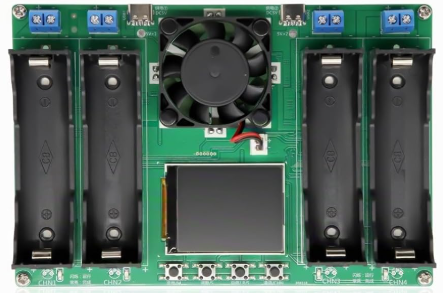
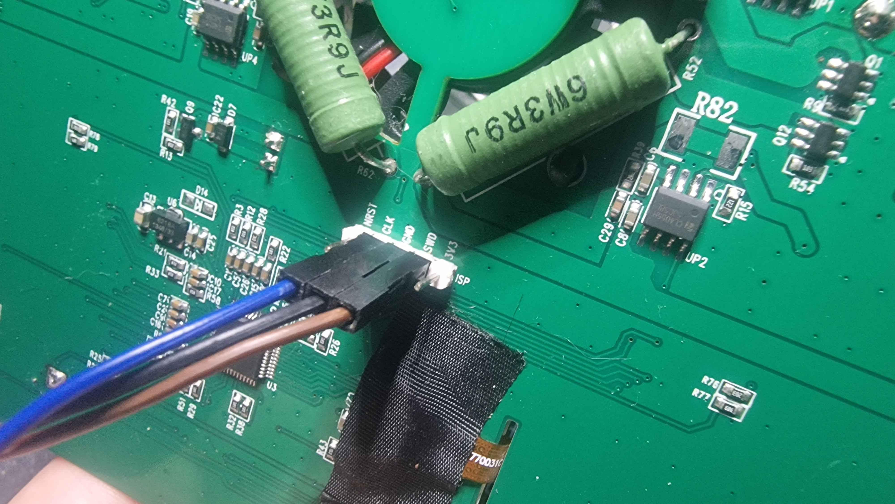

# 18650-4CHN SRAM Layout: Reverse Engineering Notes

Date: 2026-11-07

This document explains how the live data of the 18650-4CHN charger/tester was located in the SRAM of its microcontroller, what each identified field means, and how confident we are in each conclusion. It separates three kinds of statements:

- **Observed**: read directly from the device or from a capture, reproducible with the tools in this repository.
- **Validated**: an observation that was cross-checked against the device display on the reference unit.
- **Inferred / hypothesis**: a conclusion drawn from indirect evidence. It may be wrong.

Everything below was established on **one unit**, with one firmware version, by the author. Nothing here has been confirmed by the manufacturer.

## Current production rule

The bridge reads exactly two SRAM ranges and one core register, in attach mode, while the firmware runs:

| Range | Address | Size | Content |
|---|---|---|---|
| Channel block | `0x20000048` | `0xE0` (224 bytes) | Four 56-byte channel structures |
| ADC block | `0x2000041A` | `0x08` (8 bytes) | Four `uint16` ADC samples, one per slot |
| CPUID | `0xE000ED00` | 4 bytes | Core identification, used by `diagnose` only |

All values are little-endian. Any other address is refused by the transport layer (`chn4_bridge.layout.READABLE_RANGES`).

## Device

The 18650-4CHN (also sold as BT4-4CHN-18650) is a four-slot Li-ion tester: TP4056-based charging to 4.2 V, resistive discharge of about 1 A down to a selectable stop voltage (2.5 to 3.5 V in 11 steps), 1 to 9 automatic cycles, and an internal resistance reading obtained with a DC two-wire method, powered by two USB-C inputs. These characteristics come from the vendor documentation ([LaskaKit product page](https://www.laskakit.cz/en/bt4-4chn-18650-tester-li-ion-clanku-18650-4-kanaly/), [user manual](https://www.laskakit.cz/user/related_files/bt4-4chn-18650_tester_manual.pdf)), not from this work.



The underside of the board carries a five-pin header labelled `ISP` (`NRST`, `CLK`, `GND`, `SWD`, `3V3`), which exposes the MCU SWD interface. Only `CLK`, `SWD` and `GND` are needed. The device has no other data interface.



The discharge resistors visible on the same side are marked `6W3R9J`: 6 W, 3.9 Ω, 5 % tolerance.

## 1. Processor identification over SWD

**Setup.** A classic WCH-Link switched to its ARM CMSIS-DAP mode (`WCH-LinkDAP-WINUSB`), pyOCD with the generic `cortex_m` target, `connect_mode=attach`, `auto_unlock=False`, SWD at 100 kHz.

**Observed.** The CPUID register (`0xE000ED00`) reads `0x410CC601`. Decoded with the Arm field layout:

| Bits | Field | Value | Meaning |
|---|---|---|---|
| 31:24 | Implementer | `0x41` | Arm |
| 23:20 | Variant | `0x0` | r0 |
| 19:16 | Architecture | `0xC` | Armv6-M |
| 15:4 | PartNo | `0xC60` | Cortex-M0+ |
| 3:0 | Revision | `0x1` | p1 |

The core is therefore an Arm Cortex-M0+ r0p1 ([Cortex-M0+ Technical Reference Manual r0p1](https://developer.arm.com/documentation/ddi0484/c/)). `chn4-bridge diagnose` performs this read and decodes it.

**Inferred.** The MCU package marking is erased. The part was identified as a **Puya PY32F040C1BT6** from clues found in its system ROM. This identification is consistent with the observations (Cortex-M0+ core, SRAM at `0x20000000`, 16 KiB SRAM images, a 12-bit ADC) and with the [PY32F040 datasheet](https://download.py32.org/Datasheet/en/PY32F040_Datasheet_V1.1.pdf), but it remains a conclusion, not a direct observation. Nothing in the bridge depends on the exact part number. The system ROM content is not published in this repository.

## 2. Accessible memory

**Observed.** With the firmware running and the core never halted, the whole SRAM (`0x20000000`, 16 KiB) can be read over SWD. Reads do not disturb the device: the display, the charge and the discharge continue normally, and the core state reported by pyOCD stays `RUNNING` (or `SLEEPING`).

The project only ever reads SRAM. Flash, system memory and option bytes are out of scope: they are not needed to obtain the measurements, and reading or publishing the manufacturer firmware is deliberately avoided.

## 3. Repeated structures

**Method.** The slot records can be found (and re-checked on another unit) by comparing full SRAM images taken at different moments of a charge or discharge. Two things make them stand out:

- IEEE-754 `float32` values that match the numbers on the screen (mAh, mWh, V, mΩ) once decoded,
- the same pattern repeated four times at a fixed distance.

**Observed.** Four records of `0x38` (56) bytes start at `0x20000048`:

| Channel | Base address |
|---|---|
| CH1 | `0x20000048` |
| CH2 | `0x20000080` |
| CH3 | `0x200000B8` |
| CH4 | `0x200000F0` |

The four records share the same internal layout. In the reference capture the four slots hold four different cells, and each record carries its own counters, resistance and voltages.

## 4. Correlating captures with the display

A capture taken while the screen shows known values lets each candidate offset be checked. The repository ships a minimal reference capture, [`tests/fixtures/charge_4ch_real.jsonl`](../tests/fixtures/charge_4ch_real.jsonl), extracted from two 16 KiB SRAM images of the reference unit taken 9 seconds apart, while all four slots were charging and CH1 was selected on the screen. Only the channel block and the ADC block are kept.

Decoded values for CH1 in the two frames:

| Field | Frame 1 | Frame 2 | Check |
|---|---|---|---|
| `+0x04` elapsed | 39 s | 48 s | Matches the 9 s between captures |
| `+0x0C` capacity | 9.6 mAh | 11.8 mAh | Increases while charging |
| `+0x10` energy | 33.1 mWh | 40.7 mWh | Increases while charging; energy / capacity ≈ 3.45 V |
| ADC sample | 3226 counts | 3224 counts | 3.466 V and 3.464 V with the 4.4 / 4095 scale |
| `+0x28` display voltage | 3.461 V | 3.464 V | Refreshed: CH1 is the selected slot |

For CH2 the display voltage stays at 3.408 V in both frames while its ADC sample gives 3.464 V then 3.468 V: CH2 is not selected, so its cached display value is stale. This is the observation behind the distinction between `voltage_v` and `display_voltage_v`.

`chn4-bridge decode tests/fixtures/charge_4ch_real.jsonl` reproduces these numbers.

## 5. Field offsets

Confidence levels:

- **High**: validated against the device display on the reference unit, in several situations.
- **Medium**: observed and consistent, but validated in few situations or by indirect reasoning.
- **Low**: plausible interpretation, not validated.
- **Unknown**: the content is recorded but its meaning is not known.

### Channel structure (`0x38` bytes)

| Offset | Type | Unit | Bridge field | Interpretation | Confidence | Validation method |
|---|---|---|---|---|---|---|
| `+0x00` | `uint8` | | `state_code` | State: `0` stop, `1` charge (`CHGE` on screen) | High | Compared with the state shown on the screen |
| `+0x00` | `uint8` | | `state_code` | State `2` during discharge | Medium | Seen in every row of the discharge phases of the author's session logs (5,894 rows); not cross-checked with every screen state |
| `+0x01` | `uint8` | V × 10 | `stop_threshold_v` | Probable discharge stop voltage | Low | Reads 28 (2.8 V) in the reference capture, within the 2.5 to 3.5 V range of the device; not correlated with a changed setting |
| `+0x02` | `uint8` | | `experimental.byte_0x02` | Unknown | Unknown | `0` in every capture |
| `+0x03` | `uint8` | | `loop_count` | Probable cycle count setting | Low | Reads 1 in the reference capture |
| `+0x04` | `uint32` | s | `elapsed_s` | Elapsed time of the current step | High | Matches the screen timer and the spacing between captures |
| `+0x08` | `uint32` | | `experimental.word_0x08` | Unknown | Unknown | `1` in the reference capture |
| `+0x0C` | `float32` | mAh | `capacity_mah` | Capacity counter of the current step | High | Matches the screen |
| `+0x10` | `float32` | mWh | `energy_mwh` | Energy counter of the current step | High | Matches the screen; energy / capacity gives a plausible mean voltage |
| `+0x14` | `uint32` | | `experimental.word_0x14` | Unknown | Unknown | `1` in the reference capture |
| `+0x18` | `float32` | V | `experimental.voltage_candidate_a_v` | Probably the unloaded voltage of the resistance test; see the hypothesis below | Medium | Constant during a step, close to the cell voltage |
| `+0x1C` | `float32` | V | `experimental.voltage_candidate_b_v` | Probably the loaded voltage of the resistance test; see the hypothesis below | Medium | Constant during a step, slightly below `+0x18` |
| `+0x20` | `uint32` | | `experimental.word_0x20` | Unknown | Unknown | Large values (≈ 0x4CD25 to 0x52041), constant during the capture |
| `+0x24` | `uint32` | | `experimental.word_0x24` | Unknown | Unknown | `0` in the reference capture |
| `+0x28` | `float32` | V | `display_voltage_v` | Voltage cached for the display | High | Matches the screen; only refreshed for the selected slot |
| `+0x2C` | `uint32` | | `experimental.word_0x2c` | Unknown | Unknown | `0x0001xxxx`; between the two frames only the selected slot's value changed |
| `+0x30` | `float32` | mΩ | `resistance_raw_mohm` | Internal resistance before a per-channel offset | High (field) / Medium (offset) | Displayed value = raw value minus a constant per slot on the reference unit |
| `+0x34` | `uint32` | | `present` | Battery presence: `0` empty, `1` present | High | Matches the occupied slots during the author's sessions; any other value is flagged `presence_word_unexpected` |

Unknown fields are exposed by the bridge under `experimental` (with `--experimental`, `include_experimental: true`, or always in JSONL recordings), together with the raw hex of each structure, so they can be studied without changing the decoder.

### ADC buffer

| Address | Type | Unit | Bridge field | Interpretation | Confidence | Validation method |
|---|---|---|---|---|---|---|
| `0x2000041A` | `uint16` | counts | `adc_raw` (CH1) | Battery voltage ADC sample | High (location) | Changes for all four slots independently of the selected slot |
| `0x2000041C` | `uint16` | counts | `adc_raw` (CH2) | idem | High (location) | idem |
| `0x2000041E` | `uint16` | counts | `adc_raw` (CH3) | idem | High (location) | idem |
| `0x20000420` | `uint16` | counts | `adc_raw` (CH4) | idem | High (location) | idem |

`voltage_v = adc_raw × 4.4 / 4095` is an **experimental** scale. It reproduces the display voltage of the selected slot within a few millivolts in the reference capture (3224 counts gives 3.4641 V, the display holds 3.464127 V), but it has not been checked against a calibrated instrument. The scale is configurable (`adc.full_scale_v`, `adc.full_scale_counts`).

A rare zero sample was observed while a battery was present. The bridge treats zero, saturated (4095) and out-of-range samples (outside 2.0 to 4.4 V by default) as unavailable and reports `voltage_v: null` with the issue `adc_sample_invalid`, instead of a false 0 V reading.

### Hypothesis: the resistance measurement voltages

The manual states that the internal resistance is measured with a DC two-wire method. The two voltages at `+0x18` (A) and `+0x1C` (B) behave like an unloaded and a loaded cell voltage: both stay constant during a step, and A is always slightly above B. If the resistance is computed as `R = (A - B) / I` with the discharge resistor as load, `I = B / R_load` and the implied load resistance is `R_load = B × R / (A - B)`. In the reference capture:

| Channel | A (V) | B (V) | A - B (mV) | Raw R (mΩ) | Implied `R_load` (Ω) |
|---|---|---|---|---|---|
| CH1 | 3.403016 | 3.361917 | 41.1 | 48 | 3.93 |
| CH2 | 3.410134 | 3.372796 | 37.3 | 43 | 3.88 |
| CH3 | 4.059658 | 3.999756 | 59.9 | 58 | 3.87 |
| CH4 | 4.063419 | 4.005934 | 57.5 | 56 | 3.90 |

The four slots give the same load within about 1.5 %, which is the rounding error of the integer resistance values. The discharge resistors on the board are marked `6W3R9J`, that is 3.9 Ω: the load computed from the SRAM values matches the physical component, without having been chosen to. This makes the hypothesis strong, but it still rests on a single capture: the fields keep their `experimental` names until it is confirmed by watching them during a fresh resistance measurement.

The constant per-channel offset between the stored and the displayed resistance (34, 34, 40 and 40 mΩ on the reference unit) could correspond to a wiring or contact resistance compensation applied for display. That is also unconfirmed, and the offsets of another unit may differ; `chn4-bridge calibrate-resistance` measures them for your unit.

## 6. Validation of the four channels

The four channels were validated experimentally by the author on the reference unit, with the prototype that preceded this project: during live sessions the decoded values of each slot matched what the screen showed for that slot. Two behaviours were specifically confirmed on hardware:

- the four ADC samples change independently, whichever slot is selected on the screen,
- the display voltage `+0x28` only changes for the selected slot.

The reference capture shows both behaviours (section 4). The bridge decodes the four records with the same code. The automated tests check the offsets, the endianness, the four channel addresses and the presence handling with synthetic structures built from this table, and the decoding of the real reference capture.

## 7. Current estimation

No variable holding the instantaneous current shown on the screen has been identified yet. The bridge estimates it from the capacity counter, whose unit is mAh:

```text
I [A] = 3.6 × Δcapacity [mAh] / Δtime [s]
```

(1 mAh/s = 3.6 A.)

- `current_recent_a` uses the counter values over a sliding window of device time (`estimation.window_s`, 5 s by default). It needs at least two points in which the counters progressed, so it is `null` on the first snapshot and after any reset.
- `current_average_a` is `3.6 × capacity / elapsed` since the start of the step. It is the mean over the whole step, not a recent value.

Both values are labelled `estimated`. They are computed from the device's own counters, so they inherit the accuracy of the firmware accounting and lag a real current change by up to the window length. In the reference capture CH1 gains 2.19 mAh in 9 s, which gives 0.876 A while charging.

Edge cases handled by the estimator:

- **Idle slot**: when the counters stop progressing for `estimation.idle_after_s` (4 s by default) of host time, the slot is reported `idle` and the recent current is `0.0`. Idle is inferred from the counters, not from the state code: a slot can be idle in state 1 (end of charge) for instance.
- **Counter reset**: a new step resets `elapsed` and `capacity`. A decrease in either one clears the history and adds the `counter_reset` issue.
- **Insertion and removal**: an absent slot clears its history; all its measurements are `null`.
- **Host clock discontinuity**: if the monotonic timestamps go backwards (for example in a replay) the history is cleared and `host_clock_discontinuity` is reported.
- **Reconnection**: after a lost SWD connection the history of every slot is cleared.
- **NaN and infinity**: non-finite floats are discarded with a `*_not_finite` issue.

## 8. Uncertainties and current limits

- **Single unit.** One device, one firmware version. Other hardware revisions or firmware builds may move the structures; the bridge cannot detect a different layout on its own. `diagnose` compares the CPUID with the reference value, which detects a different core, not a different firmware.
- **Firmware and PCB variants.** Several sellers offer visually similar four-slot testers. None of them has been tested. Do not assume compatibility because the product name matches.
- **Torn reads.** A 224-byte SWD read is not atomic with respect to the firmware. The bridge reads the channel block twice and compares the state, counters, resistance and presence fields (offsets `0x00` to `0x17` and `0x30` to `0x37` of each record); the voltages are excluded because they may legitimately change between two reads. Each snapshot is marked `consistent`, `inconsistent` (still different after the configured retries) or `unverified` (check disabled, or offline data).
- **ADC scale.** Experimental, see above.
- **State codes.** Only 0, 1 and 2 have been observed. The end-of-test indication of the screen (`END`) has not been mapped to a field.
- **Settings.** `+0x01` and `+0x03` are probable interpretations of the stop voltage and cycle count settings and have not been validated by changing those settings.
- **Unknown fields.** `+0x02`, `+0x08`, `+0x14`, `+0x20`, `+0x24` and `+0x2C` are not identified. `+0x18` and `+0x1C` have a hypothesis but no confirmation.

## How the bridge stays passive

pyOCD is configured so that it does not act on the target beyond what a read needs:

| Option | Value | Why |
|---|---|---|
| `target_override` | `cortex_m` | Generic core support, no device-specific flash algorithm |
| `connect_mode` | `attach` | Connect without halting the core ([pyOCD session options](https://pyocd.io/docs/options.html)) |
| `auto_unlock` | `False` | The default would mass erase a locked device to gain access |
| `resume_on_disconnect` | `False` | Leave the core state unchanged on disconnect |
| `cache.enable_memory` | `False` | Every snapshot comes from the target, not from a cache |
| `no_config` | `True` | Ignore any `pyocd.yaml` that could change these options |

pyOCD also loads a [user script](https://pyocd.io/docs/user_scripts.html) named `pyocd_user.py` or `.pyocd_user.py` from its project directory automatically; such a script can run arbitrary target operations. The bridge refuses to attach when one is present in the working directory.

When it attaches, pyOCD powers up the debug port and enables core debug, as any SWD debugger does. These are accesses to debug system registers, not to application memory, and they do not halt the core. The bridge itself only calls `read_memory_block8` on the allowlisted ranges and `get_state`; the tests use a fake target that fails on any other call.

## Reproducing the analysis

1. Wire the probe and switch a WCH-Link to `WCH-LinkDAP-WINUSB` as described in the [README](../README.md#switching-a-wch-link-to-cmsis-dap-arm-mode).
2. `chn4-bridge diagnose` checks the probe, the core state and the CPUID, and times the reads.
3. `chn4-bridge record --raw session.capture.jsonl --note "what the screen shows"` records the channel and ADC blocks once per second. Change one thing at a time on the device (insert a cell, start a charge, change the selected slot) and note the time.
4. `chn4-bridge decode session.capture.jsonl --json --experimental` shows every field, including the unidentified ones and the raw hex of each structure.

Raw captures contain only the 232 bytes of the two allowlisted blocks per frame, so they can be shared in an issue without leaking anything else from the device memory.

## References

- Arm, [Cortex-M0+ Technical Reference Manual r0p1](https://developer.arm.com/documentation/ddi0484/c/).
- Puya Semiconductor, [PY32F040 datasheet V1.1](https://download.py32.org/Datasheet/en/PY32F040_Datasheet_V1.1.pdf) and [PY32F040 series documents](https://py32.org/en/mcu/PY32F040xx); [Puya Semiconductor](https://www.puyasemi.com/en/).
- Arm, [CMSIS-DAP](https://arm-software.github.io/CMSIS_5/DAP/html/index.html).
- pyOCD, [project site](https://pyocd.io/), [session options](https://pyocd.io/docs/options.html), [user scripts](https://pyocd.io/docs/user_scripts.html), [debug probes](https://pyocd.io/docs/debug_probes.html), [source](https://github.com/pyocd/pyOCD).
- WCH, [WCH-Link](https://www.wch-ic.com/products/WCH-Link.html) and [WCH-LinkUtility](https://www.wch-ic.com/downloads/WCH-LinkUtility_ZIP.html).
- LaskaKit, [BT4-4CHN-18650 product page](https://www.laskakit.cz/en/bt4-4chn-18650-tester-li-ion-clanku-18650-4-kanaly/) and [user manual](https://www.laskakit.cz/user/related_files/bt4-4chn-18650_tester_manual.pdf).
